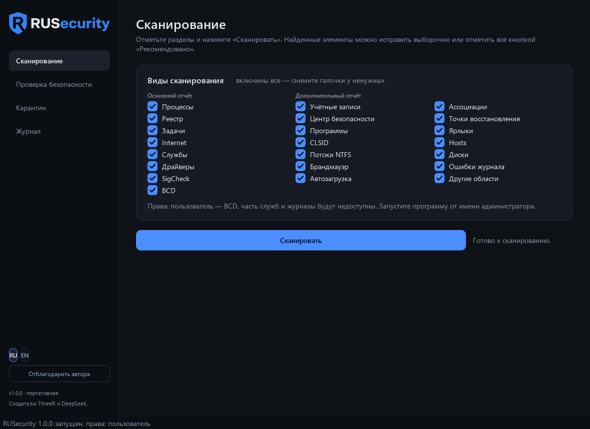

# RUSecurity

[](https://github.com/NoobDev68/RUSecurity/actions/workflows/tests.yml)


Портативный сканер и чистильщик Windows с графическим интерфейсом. Находит
подозрительные записи автозагрузки, задачи, службы, драйверы, правила
брандмауэра, расширения и настройки браузеров, проблемы с hosts и политиками,
проверяет параметры безопасности системы — и исправляет выбранное **с бэкапом,
карантином и возможностью отката**.

Один файл, без установки и без записей в реестр: отчёты, настройки и резервные
копии лежат рядом с программой в папке `Reports\`.

[**Скачать RUSecurity.exe**](https://github.com/NoobDev68/RUSecurity/releases/latest) ·
[**Отблагодарить автора**](https://boosty.to/threer/donate)


## Возможности

- **Сканер системы** — процессы, автозагрузка (`Run`, `Winlogon`, Active Setup,
  папки Startup, `MountPoints2`, политики, `AppInit_DLLs`, IFEO), службы и
  драйверы, задачи планировщика, браузеры (профили, расширения, поиск, домашние
  страницы), hosts, брандмауэр, пользовательские CLSID, точки восстановления,
  потоки NTFS, подписи системных файлов (SigCheck), BCD, ассоциации файлов.
- **Анализ и список найденного** — каждая запись показывается с категорией,
  действием и полным путём; рядом галочка, кнопки «Рекомендовано» и «Исправить».
- **Проверка безопасности** — отдельный аудит параметров Windows: LSA/NTLM,
  WDigest, RDP, SMB, LLMNR, профили брандмауэра, журналирование PowerShell,
  журнал Security, автообновление, исключения Defender. У каждого пункта
  описаны польза, возможные минусы и способ исправления.
- **Исправление с обратимостью** — точка восстановления, резервные копии веток
  реестра, карантин файлов, журнал исправления.
- **Откат** — в «Журнале» можно вернуть любое исправление целиком: файлы, ветки
  реестра, hosts.
- **Карантин** — вернуть выбранные объекты, удалить их навсегда или очистить
  карантин.
- **Журнал** — время запуска, найденные элементы, что удалено, ошибки и где
  лежат бэкапы.
- Тёмная тема; русский и английский интерфейс переключается на лету, без
  перезапуска программы.



## Скачать и запустить

1. Скачать `RUSecurity.exe` из [последнего релиза](https://github.com/NoobDev68/RUSecurity/releases/latest).
2. Запустить: Windows запросит права администратора — без них недоступны BCD,
   часть служб и журналы.
3. Нажать «Сканировать», посмотреть найденное, при необходимости снять галочки
   и нажать «Исправить».

Сборка не подписана, поэтому SmartScreen может предупредить — «Подробнее» →
«Выполнить в любом случае».

## Запуск из исходников

Нужны Windows 10/11 и Python 3.11+.

```powershell
python -m pip install -r requirements.txt

python -m rusecurity              # интерфейс
python -m rusecurity scan         # сканирование, отчёты в Reports\
python -m rusecurity analyze Reports\rusecurity-report.txt -o Reports\rusecurity-fix.txt
python -m rusecurity apply Reports\rusecurity-fix.txt --dry-run
python -m rusecurity hardening    # проверка безопасности из консоли
python -m rusecurity restore Reports\Backups\<дата>
```

Интерфейс — PySide6; лаунчер для исходников — `Запустить RUSecurity.bat`.

## Сборка exe

```powershell
python -m pip install -r requirements-dev.txt
python -m PyInstaller --noconfirm --clean --onefile --windowed --uac-admin `
  --runtime-tmpdir . --paths .runtime --name RUSecurity `
  --icon "$PWD\assets\RUSecurity.ico" --add-data "$PWD\assets;assets" `
  --distpath dist --workpath build --specpath build RUSecurity.py
```

Путь к ассетам абсолютный: при `--specpath build` относительные пути
`--add-data` считаются от каталога spec, а не от корня проекта.

`--add-data` кладёт логотип и иконку окна внутрь exe; без него в сайдбаре
останется текстовая надпись вместо логотипа.

## Проверка безопасности

Отдельный раздел приложения: сверяет параметры Windows с рекомендуемыми
значениями и показывает только отклонения. Исправление идёт через общий
механизм — с бэкапом ветки реестра и точкой восстановления, поэтому любой пункт
можно откатить. Для проверок, которые нельзя безопасно исправить автоматически
(включённый RDP, ограничение исходящего NTLM, подменённый сервер обновлений),
показываются инструкция в интерфейсе Windows и готовая команда PowerShell.

## Требования

- Windows 10/11.
- Права администратора (exe запрашивает их сам через UAC).
- Для исходников — Python 3.11+ и PySide6 для интерфейса.

## Тесты

```powershell
python -m pytest tests -v
```

Покрыты парсер отчётов, детекторы, формат списка исправлений, фиксер
(реестр, файлы, карантин, откат), проверка безопасности, правки браузерных
настроек и связка «сканер → анализ → исправление».

## Структура

- `RUSecurity.py` — точка входа.
- `rusecurity/` — приложение.
  - `core/winapi.py` — реестр, подпись и версия файла, ярлыки, процессы;
  - `core/sections/` — сбор данных по разделам;
  - `core/scanner.py` — сборка отчёта;
  - `core/hardening.py` — правила проверки безопасности;
  - `analyzer.py` — анализ и список исправлений;
  - `fixer/` — выполнение исправлений, бэкапы, карантин, откат, правка
    браузерных профилей;
  - `journal.py` — журнал действий (`Reports\rusecurity-journal.txt`);
  - `ui/` — окно, страницы сканирования, проверки безопасности, карантина и журнала.
- `GenFix.py` — движок детекции и сборки списка исправлений.
- `assets/` — логотип и иконка.
- `docs/` — скриншоты.
- `tests/` — тесты.

## Ограничения

- Детекция эвристическая: возможны ложные срабатывания и пропуски, особенно на
  самописных службах и нестандартных путях.
- Правки браузерных настроек не удаляют поисковый движок из списка
  Chrome/Edge, а только сбрасывают выбор и домашнюю страницу.
- Для исправлений, затрагивающих службы и драйверы, может потребоваться
  перезагрузка — программа предложит её после исправления.

## Поддержать проект

Программа бесплатная и портативная. Если она помогла — можно отблагодарить
автора: [**boosty.to/threer/donate**](https://boosty.to/threer/donate).
Ссылка также есть в приложении (кнопка «Отблагодарить автора» внизу сайдбара)
и в кнопке «Sponsor» на этой странице.

## Лицензия

MIT — см. [LICENSE](LICENSE). Программа поставляется как есть, без гарантий:
решения об удалении системных записей принимает пользователь.
